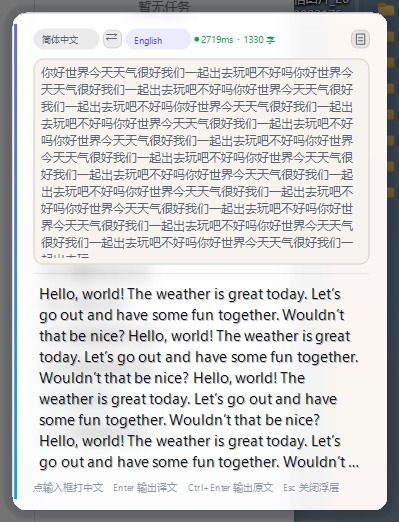

# LumiType 灵译

实时打字翻译浮层：在聊天或编辑软件中按 **Alt+Y** 唤出卡片，输入中文实时显示高质量译文，按 **Enter** 直接将译文落回原软件光标处——不复制、不粘贴、不切窗口。

A real-time typing translation overlay: press **Alt+Y** to summon a floating card next to your caret, type, and press **Enter** to paste the translation directly back into your target app (WeChat, WhatsApp, Feishu, DingTalk, Notepad, Mailbird, and more). No copy-paste, no context switching.



---

## 下载 / Download

| 文件 / File | 说明 / Description |
|---|---|
| [`LumiType.exe`](https://raw.githubusercontent.com/Githuber-tech/LumiType-Translation/main/LumiType.exe) | 单文件绿色版，无安装、无依赖 / Portable single file, zero dependencies |

- **Releases 页面**：<https://github.com/Githuber-tech/LumiType-Translation/releases>
- **最新版本直链**：<https://raw.githubusercontent.com/Githuber-tech/LumiType-Translation/main/LumiType.exe>
- **更新清单**：[`latest.json`](latest.json)

---

## 快速上手 / Quick Start

1. 将 `LumiType.exe` 放置在任意目录双击运行，程序常驻系统托盘（青紫色「译」图标）。
2. 首次运行会在同目录下生成 `config\settings.json`，在首选项「翻译引擎」或配置文件中填入你的 API Key（支持 DeepL / Google / LLM）：
   ```json
   { "DeeplKey": "your-key:fx", "UiLang": "zh" }
   ```
   *（DeepL Free Key 申请：<https://www.deepl.com/developer> → Your apps → Create new app，每月免费 50 万字符）*
3. 按 **Alt+Y** 随时随地唤出浮层，打字，按 **Enter** 即可输出译文。

---

## 快捷键与操作 / Hotkeys & Actions

| 快捷键 / Hotkey | 作用 / Action |
|---|---|
| `Alt+Y` | 在光标旁唤出并激活翻译浮层 / Open overlay at caret |
| `Ctrl+Alt+Y` | 翻译剪贴板内容 / Translate clipboard text |
| 浮层内 `Enter` | 将译文回填至原软件 / Paste translation into target app |
| 浮层内 `Ctrl+Enter` | 输出原文 / Output original text |
| 浮层内 `Shift+Enter` | 输入框内换行 / New line in input |
| 浮层内 `Tab` | 切换翻译引擎（DeepL / Google / LLM） / Cycle translation engine |
| 卡片右上角 `✕` | 关闭浮层 / Close overlay |

---

## 功能特性 / Features

- **多翻译引擎**：支持 DeepL、Google 翻译以及 LLM（DeepSeek 等大模型），毫秒级响应。
- **10 种语言互译**：内置简体中文、繁体中文、English、日本語、한국어、Français、Deutsch、Español、Português、Русский，支持输入自动识别与双向对换。
- **智能窗口吸附**：支持贴边吸附至微信、WhatsApp、飞书、钉钉、记事本、Mailbird 等窗口，宽度自适应，跟随窗口移动与最小化联动。
- **美观拟态视觉**：三种精美皮肤（暗色磨砂、浅色、主题色），支持 15%~100% 磨砂玻璃透明度平滑调节。
- **零依赖与隐私保护**：基于原生 Win32 / GDI+ 构建，无任何外部运行库依赖；API Key 仅存放于本地，绝不上传。
