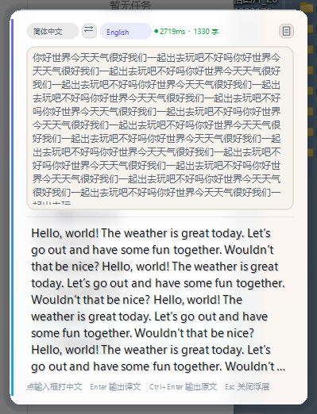

# LumiType - Real-time typing translation overlay for Windows

Type in a floating overlay next to your caret, press **Enter**, and the DeepL-powered
translation is pasted back into the chat app or Mailbird email compose window (WeChat,
WhatsApp, Feishu, DingTalk, Notepad, Mailbird, and most windows). No copy-paste, no
context switching. A single portable `.exe` - no
installer, no dependencies.



## Download
- **Releases:** <https://github.com/Githuber-tech/LumiType-Translation/releases> (download `LumiType.exe`)
- Direct link (always the latest): <https://raw.githubusercontent.com/Githuber-tech/LumiType-Translation/main/LumiType.exe>
- Integrity: the release notes and [`latest.json`](latest.json) carry the SHA256 of the exe.

## Quick start (3 steps)
1. Put `LumiType.exe` anywhere (e.g. `D:\Tools\LumiType\`) and double-click. It lives in the tray.
2. First run creates `config\settings.json` next to the exe - fill in **your own** DeepL API key:

   ```json
   { "ApiKey": "your-key:fx", "SourceLang": "English", "TargetLang": "Simplified Chinese", "UiLang": "zh" }
   ```

   - Get a free key: register at <https://www.deepl.com/developer> → *Your apps* → *Create new app*
     (free tier: 500,000 characters per month).
   - Save the file, then restart the app (or tray → *Reload config*).
3. Press **Alt+Y** (default) to summon an overlay anywhere. Type, then **Enter** sends the translation.

## Hotkeys
| Key | Action |
|---|---|
| Alt+Y | Open / activate a new overlay (multiple independent ones allowed) |
| Ctrl+Alt+Y | Translate the clipboard content |
| Enter | Snapped: paste the translation into the snapped app · Free: output at your original caret |
| Ctrl+Enter | Output the original text |
| Esc | Close the active overlay (ignored while snapped) |

Translation pair (10 built-in languages), interface language (zh/en), glass opacity, skin and
hotkeys are all changeable in **tray → Preferences**.

## Auto update
While online, the app checks the version manifest at startup and every 6 hours, and offers a
one-click update from the tray (menu → *Check for updates*). Manifest: [`latest.json`](latest.json).

## Privacy
No telemetry, no analytics. The only network calls are the DeepL translation API and the
optional update check. Your API key is stored in plain text on your own machine and never
leaves it - each user should use their own key.

---

## 中文说明

LumiType 灵译：把光标旁的浮层当输入框打字，按 **Enter**，DeepL 译文直接插回聊天软件
（微信 / WhatsApp / 飞书 / 钉钉 / 记事本等），免复制粘贴、免切换窗口。单文件绿色版，无安装、无依赖。

**下载**：Releases 页下载 `LumiType.exe`，或用上面的直链（始终最新版）。

**上手三步**：
1. 把 `LumiType.exe` 放到任意目录，双击运行；程序常驻托盘；
2. 首跑会在 exe 旁生成 `config\settings.json`，填入**你自己的** DeepL API Key
   （<https://www.deepl.com/developer> 注册 → *Your apps* → *Create new app*，
   免费档每月 50 万字符；key 以明文保存在你自己电脑上，请自行保管）；保存后重启程序或托盘 → 重新加载配置；
3. 按 **Alt+Y** 唤出浮层，打字，**Enter** 输出译文。

界面语言（中/英，V5.2.0 起）、翻译语言对、透明度、皮肤、快捷键：托盘 → 首选项。
联网时启动后及每 6 小时自动检查更新，托盘可一键升级。无遥测、无统计；你的 key 不会离开本机。
